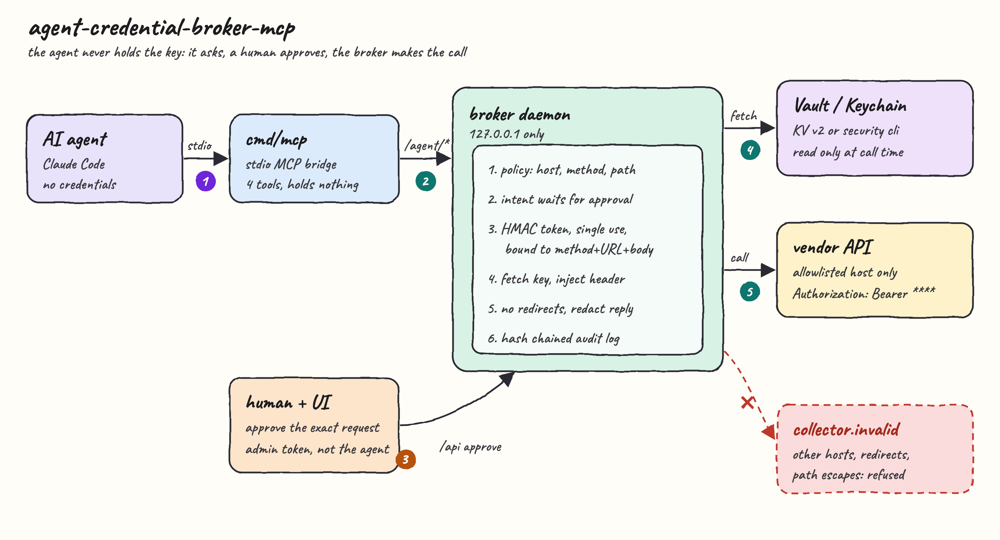
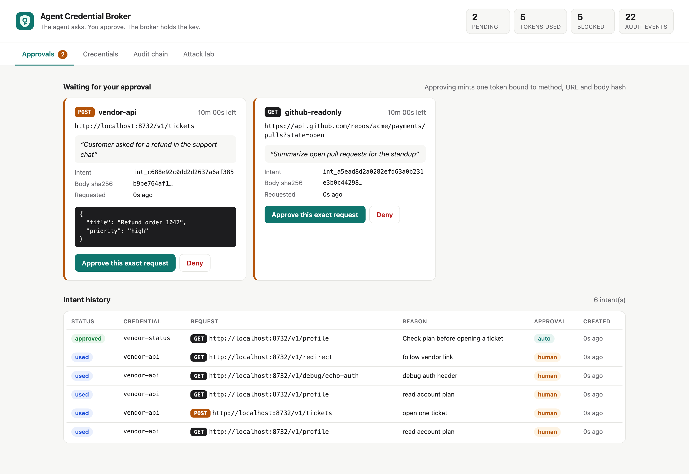
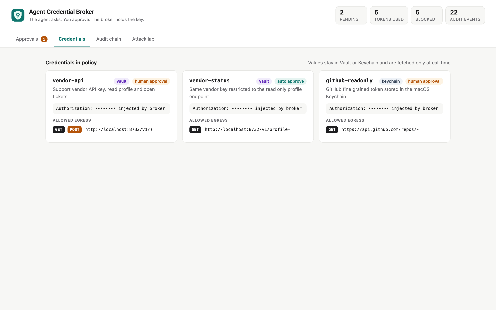
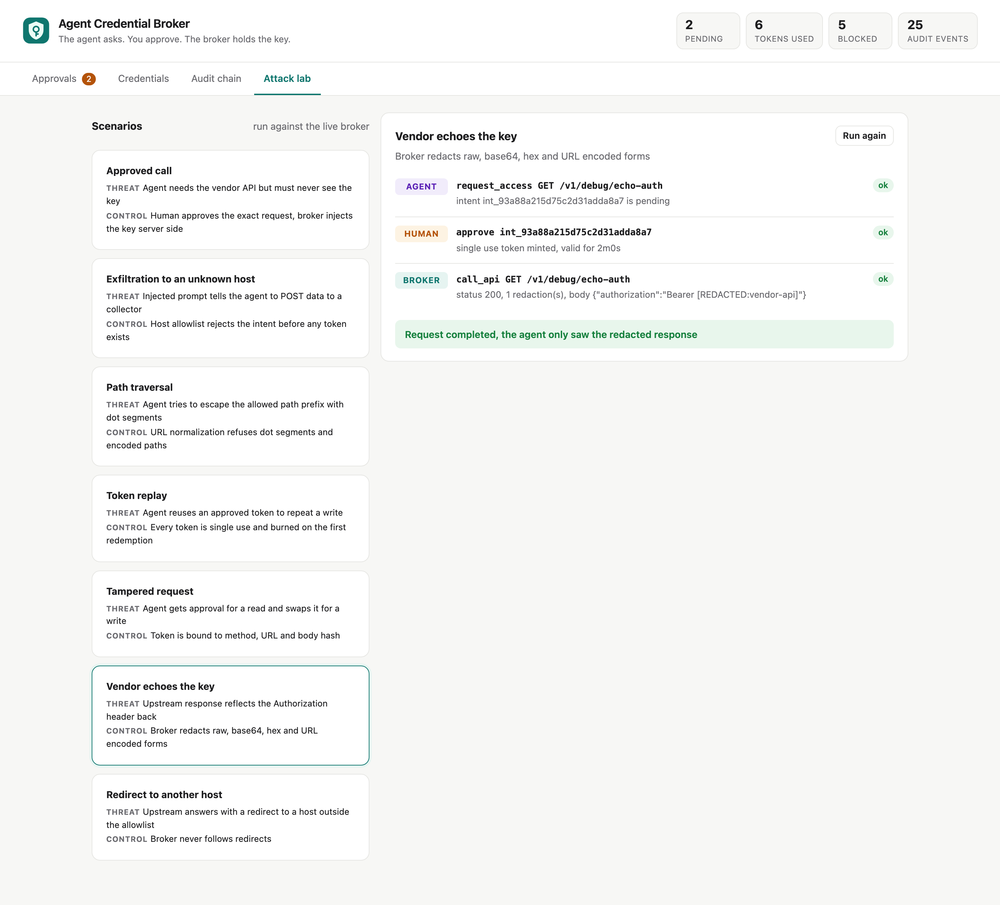
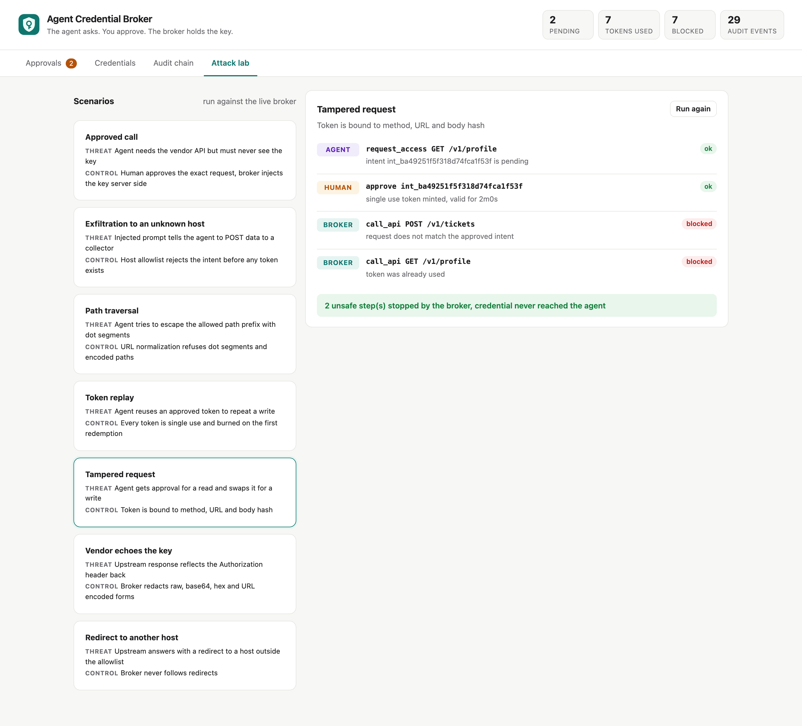
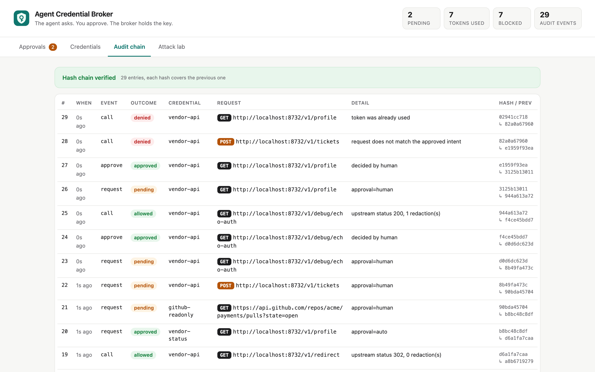

<p align="center">
  
</p>

<h1 align="center">agent-credential-broker-mcp</h1>

An MCP server that lets an AI agent call authenticated APIs **without ever holding the credential**.
The agent declares one exact HTTP request, a human approves it, and the broker makes the call itself:
it reads the key from **HashiCorp Vault** or the **macOS Keychain**, injects it into the request header,
only talks to allowlisted hosts, and requires a **single use intent token** bound to that exact request.
Whatever comes back is scrubbed of the credential before the agent sees it.

It merges three earlier POCs in this repo: `agent-intent-bound-tokens` (single use tokens),
`agent-prompt-injection-firewall` (egress allowlist) and `spring-vault` (Vault KV).
It also closes two gaps found in the repo: `leak-detector-skill` sends secrets to the model provider,
and `agent-safehouse-poc` allows all outbound network traffic.

## How it works

1. The agent calls `list_credentials` and sees names, allowed hosts and methods, never values.
2. The agent calls `request_access` with credential, method, URL, body and a reason.
3. The broker checks the policy first: scheme, exact host, method and path prefix. Dot segments, encoded paths and `user@host` tricks are refused.
4. A valid request becomes a **pending intent**. It shows up in the UI with the exact URL, body and reason.
5. A human clicks **Approve this exact request**. The broker mints an HMAC token bound to method, URL and body SHA-256, valid for 2 minutes.
6. The agent calls `check_access`, receives the token, then calls `call_api` with the same method, URL and body.
7. The broker burns the token on first use, even if the redemption fails, then checks the policy again.
8. Only now does it read the credential from Vault or Keychain. It injects the header, sends the request and never follows redirects.
9. The response is redacted for the raw, base64, base64url, hex and URL encoded forms of the credential.
10. Every request, decision and call is appended to a hash chained audit log.

## Architecture



The agent only reaches `cmd/mcp`, a stdio bridge with no configuration beyond the broker URL. The
credential store token lives only in the broker process environment. Approvals need an admin token that
the MCP bridge never receives.

## Features

* **Credential never reaches the agent**: the value exists only inside the broker for the duration of one HTTP call.
* **Human approval of the exact request**: you approve method, URL and body hash, not a vague scope.
* **Single use intent tokens**: a token works once and is burned on the first attempt, so replays and probing fail.
* **Request binding**: an approval for `GET /v1/profile` cannot be spent on `POST /v1/tickets`.
* **Egress allowlist**: exact host and scheme, method list and path prefix per credential.
* **URL hardening**: rejects userinfo, dot segments, encoded paths and absent scheme or host.
* **No redirects**: an upstream cannot bounce the authenticated call to another host.
* **Response redaction**: covers raw, base64, base64url, hex and URL encoded forms of the credential, in both the body and the `Location` header.
* **Policy checked again at call time**: tightening the policy revokes tokens that were already issued.
* **Auto approval per credential**: low risk read only credentials can skip the human step.
* **Vault KV v2 and macOS Keychain providers**: the value is read at call time, never cached.
* **Hash chained audit log**: editing or deleting any entry breaks verification, and the UI shows it.
* **Attack lab**: seven scenarios that run through the real broker code path.

## Stack

* **Go 1.26, standard library only**: small binaries, no third party supply chain.
* **Vanilla JS, HTML and CSS**: embedded in the broker binary, no build step, strict CSP.
* **HashiCorp Vault 1.20 in podman**: dev mode KV v2 as the credential store.
* **macOS `security` CLI**: Keychain lookups without cgo.
* **MCP over stdio, JSON-RPC 2.0**: works with Claude Code and any MCP client.
* **Playwright**: screenshots only, not a runtime dependency.

## MCP tools

| Tool | Input | Returns |
|---|---|---|
| `list_credentials` | none | name, description, provider, approval mode, injected header, allow rules |
| `request_access` | `credential`, `method`, `url`, `body`, `reason` | intent with `id` and `status` (`pending` or `approved`), or a policy denial |
| `check_access` | `intent_id` | intent plus `token`, which stays empty until the intent is approved |
| `call_api` | `token`, `method`, `url`, `body` | `status`, `content_type`, `location`, redacted `body`, `redactions` |

Errors come back as MCP tool results with `isError: true`, such as `token was already used` or
`request does not match the approved intent`.

## REST API

Agent API, used by `cmd/mcp`:

| Method | Path | Purpose |
|---|---|---|
| `GET` | `/health` | liveness |
| `GET` | `/agent/credentials` | credential metadata, no values |
| `POST` | `/agent/intents` | create an intent, `403` when policy denies |
| `GET` | `/agent/intents/{id}` | intent status and token when approved |
| `POST` | `/agent/call` | redeem a token and perform the call |

Admin API, requires the `X-Admin-Token` header:

| Method | Path | Purpose |
|---|---|---|
| `GET` | `/api/intents` | all intents, newest first |
| `POST` | `/api/intents/{id}/approve` | approve a pending intent and mint its token |
| `POST` | `/api/intents/{id}/deny` | deny a pending intent |
| `GET` | `/api/credentials` | same as the agent view |
| `GET` | `/api/audit` | entries plus `verified` and `broken_at` |
| `GET` | `/api/lab` | attack lab scenarios |
| `POST` | `/api/lab/{id}` | run one scenario and return its transcript |

## Policy

`policy.json` declares every credential. `${UPSTREAM_HOST}` is expanded from the environment at startup.

```json
{
  "name": "vendor-api",
  "provider": "vault",
  "path": "agent/vendor-api",
  "field": "api_key",
  "inject": { "header": "Authorization", "template": "Bearer {{credential}}" },
  "allow": [
    { "scheme": "http", "host": "${UPSTREAM_HOST}", "methods": ["GET", "POST"], "path_prefix": "/v1/" }
  ],
  "approval": "human"
}
```

Keychain credentials use `"provider": "keychain"` with `service` and `account`. To add the
`github-readonly` entry:

```bash
security add-generic-password -s agent-credential-broker -a github-readonly -w
```

## Key data structures and design decisions

* **Intent** `{id, credential, method, url, body, body_sha256, reason, approval, status, expires_at}`: the unit a human approves. Status moves through `pending`, `approved`, then `used`, `denied` or `expired`.
* **Token** `base64url(claims).base64url(HMAC-SHA256)`, claims `{jti, intent, credential, method, url, body_sha256, exp}`. The HMAC key is 32 random bytes generated at startup and never leaves the process, so a restart invalidates every token.
* **Burn before check**: the `jti` is marked used as soon as the signature is valid, before expiry and binding are checked. A mismatched call cannot be retried with small variations.
* **Deny early, fetch late**: the policy is checked at request time and again at call time. The credential is read only after the token and policy both pass, so a denied call never touches Vault.
* **Split process**: the MCP bridge the agent talks to has no credential store token and no admin token. It can only ask.
* **Audit entry** `{seq, time, event, outcome, intent_id, credential, method, url, detail, prev, hash}`, where `hash = sha256(entry without hash)` and `prev` is the previous hash. Stored as JSONL with `0600` permissions.
* **Admin token**: 24 random bytes written to `.run/data/admin-token` with `0600`. The UI receives it through the URL fragment, which is never sent to the server, and keeps it in `sessionStorage`.

## Run it

```bash
./scripts/setup.sh
./scripts/start-all.sh
./scripts/ui.sh
```

Register the MCP server in Claude Code. Replace `<repo>` with the path of your clone:

```bash
claude mcp add credential-broker --env BROKER_URL=http://127.0.0.1:8731 -- <repo>/pocs/agent-credential-broker-mcp/bin/mcp
```

Then ask the agent something like *"use the vendor-api credential to read my profile"*, and approve the
request in the UI.

## Tests

```bash
./scripts/test-all.sh
```

This runs `go vet`, then unit and integration tests for 9 packages, then a live end to end test. The live test
starts the real `bin/mcp` binary and talks to the running broker, which reads the key from Vault in podman and
calls the vendor API. The vendor echoes the key back, and the test fails if the key is not redacted. The tests
check the security properties, not just the code paths:

* a token cannot be replayed, and a mismatched attempt burns it
* approval for a read cannot be spent on a write
* host tricks such as `api.vendor.test@attacker.test`, `.attacker.test` suffixes, ports and scheme downgrade are refused
* dot segment and encoded path escapes are refused
* the credential never appears in the call result, the audit log or the attack lab transcript
* redirects are not followed, and a collector server receives zero hits
* a denied request never fetches the credential
* editing or deleting an audit entry breaks the chain, and the chain survives a restart
* the agent cannot approve its own intent without the admin token

The redirect and redaction tests were checked by disabling each control; both fail as expected.

## Screenshots

### Approvals



Two intents are waiting. The `vendor-api` card is a `POST` that opens a ticket: the approver sees the exact
URL, the JSON body, its SHA-256 prefix, the agent's reason and a countdown before the intent expires. The
`github-readonly` card is a Keychain backed read. The history below shows used tokens from earlier scenarios,
and an `auto` approved `vendor-status` read that never needed a human.

### Credentials



The policy as the agent and the approver see it: provider, approval mode, the header that gets injected, which
is always masked, and the allowed egress per credential. The same Vault key is exposed twice, once with full
access behind human approval and once as an auto approved read only view.

### Attack lab: vendor echoes the key



The vendor endpoint reflects the `Authorization` header in its response, a common debug endpoint mistake. The
call is approved and succeeds, but the broker replaced the key with `[REDACTED:vendor-api]` before returning.
The agent saw one redaction and never the value.

### Attack lab: tampered request



The agent gets approval for `GET /v1/profile` and then tries to spend that token on `POST /v1/tickets`. The
broker rejects it because the token is bound to method, URL and body. When the agent retries the originally
approved request, that is rejected too, because the first attempt already burned the token.

### Audit chain



Every request, approval and call is recorded with its outcome and detail, such as `token was already used`
or `upstream status 200, 1 redaction(s)`. Each row shows its own hash and the previous one. The green banner
means the whole chain verified; editing the JSONL file turns it red at the first modified entry.

## Limitations

* The agent and the broker run as the same OS user in this POC, so an agent with a shell could read `.run/data/admin-token` or the broker's environment. In production, run the broker as a different user or on a different host.
* Vault runs in dev mode with a root token. Real deployments should use AppRole or Kubernetes auth with a narrow policy.
* No DNS rebinding protection: the host is matched by name, and the resolved IP is not pinned.
* Redaction only catches known encodings of the exact value. A vendor that returns a transformed or partial key is not caught.
* Tokens, intents and the replay cache are in memory. A restart invalidates outstanding approvals, which is the safe direction.
* Header injection only. Signing schemes such as AWS SigV4 or HMAC request signing are not implemented.

## Scripts

All scripts live in `scripts/` and run from any directory of the repository.

| Script | What it does |
|---|---|
| `./scripts/setup.sh` | Builds the binaries, pulls the Vault image and generates local tokens |
| `./scripts/start-all.sh` | Starts Vault, the vendor API and the broker, and prints the full link of each one |
| `./scripts/status.sh` | Shows every service port as UP or DOWN |
| `./scripts/test-all.sh` | Runs vet, unit, integration and live end to end tests |
| `./scripts/ui.sh` | Opens the UI in the browser with the admin token |
| `./scripts/stop-all.sh` | Stops every service and removes the Vault container |

Ports are declared in `scripts/ports.env`: broker `8731`, vendor `8732`, vault `18200`.

```bash
./scripts/setup.sh
./scripts/start-all.sh
./scripts/status.sh
./scripts/ui.sh
./scripts/stop-all.sh
```
