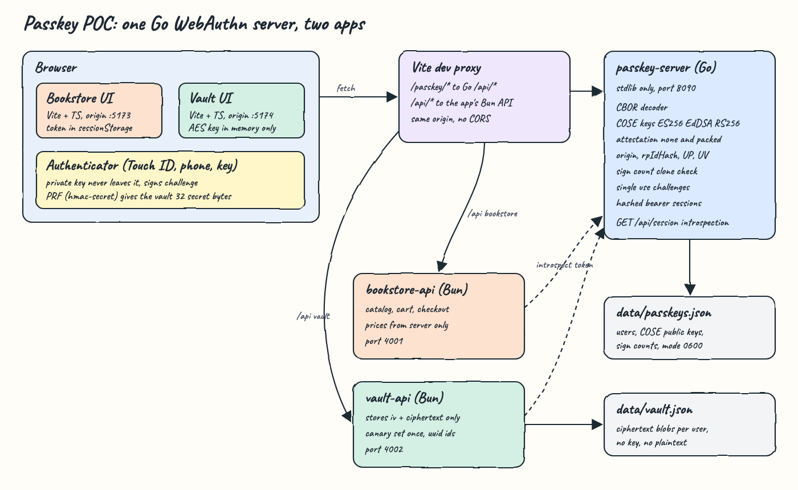
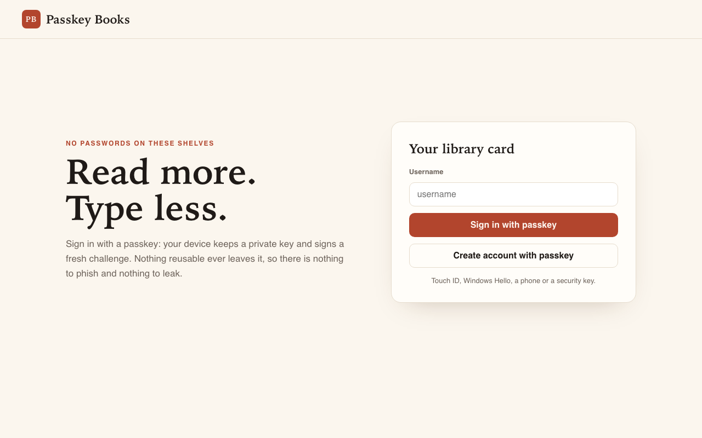
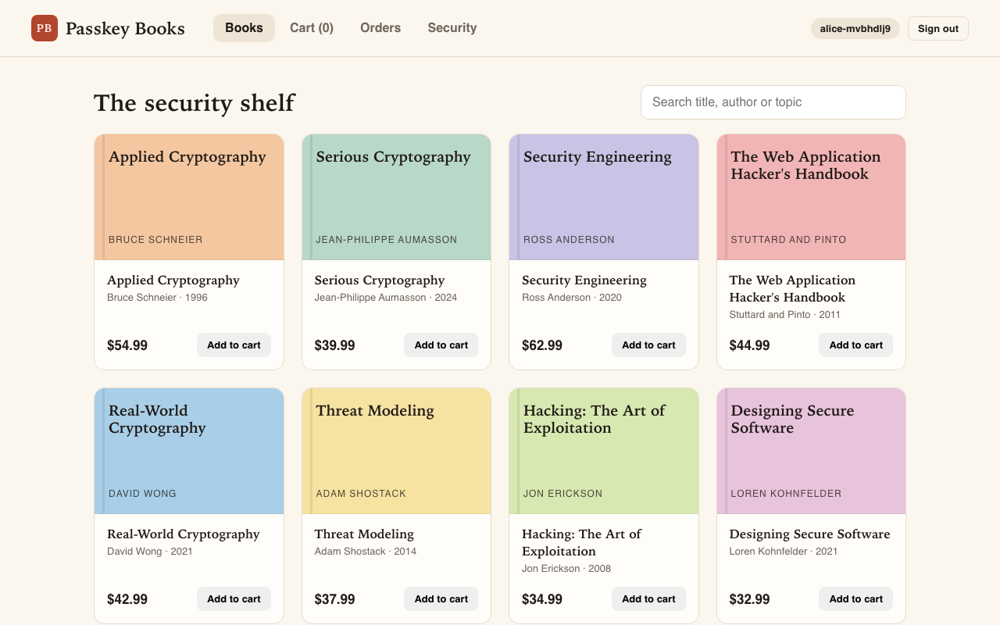
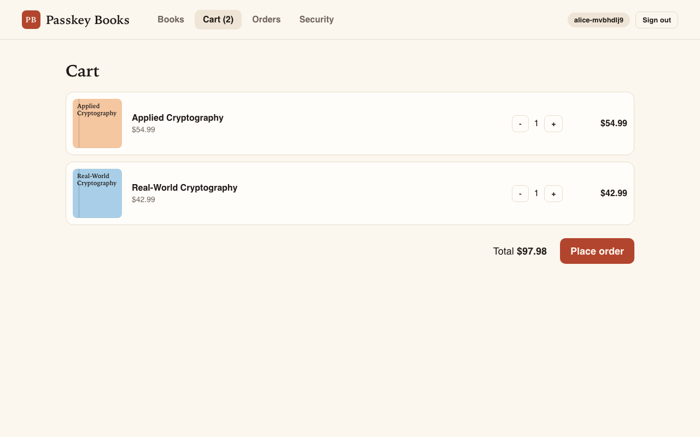
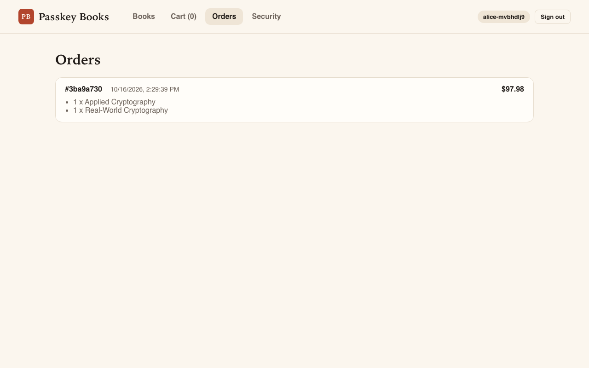
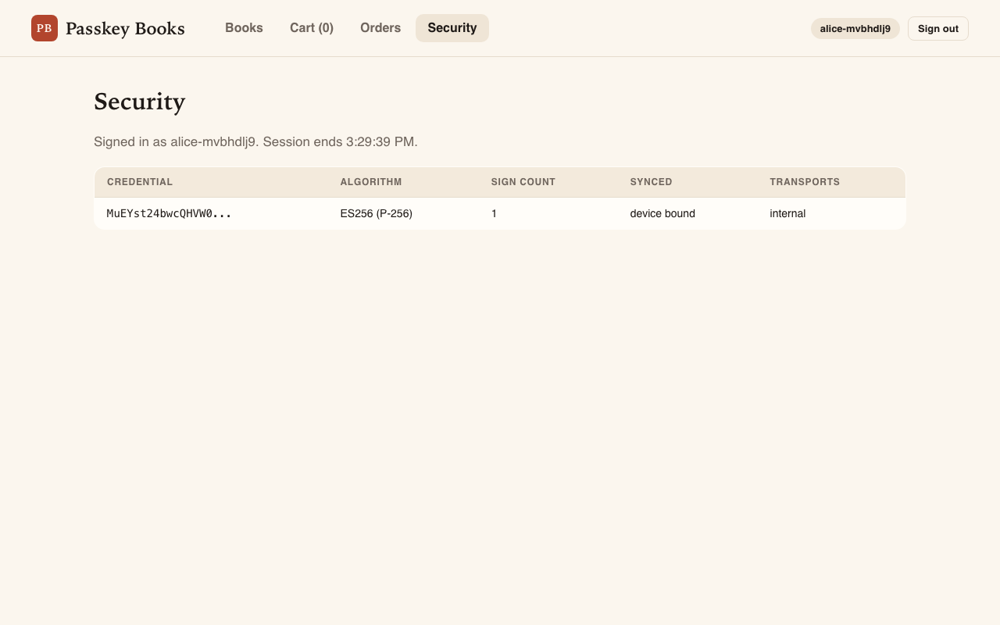
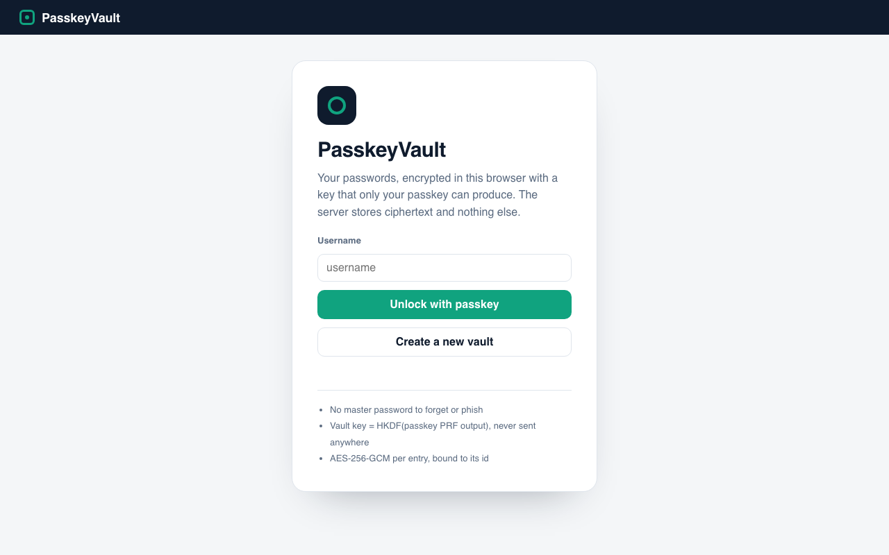
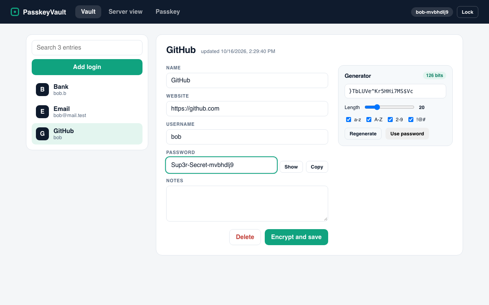
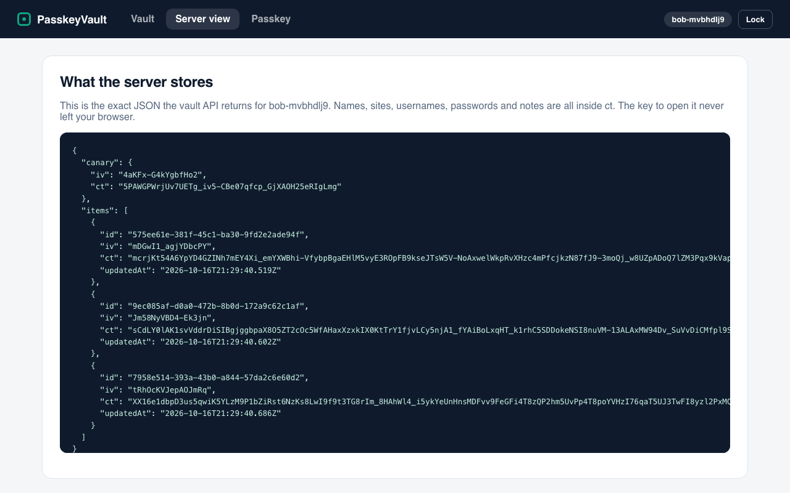
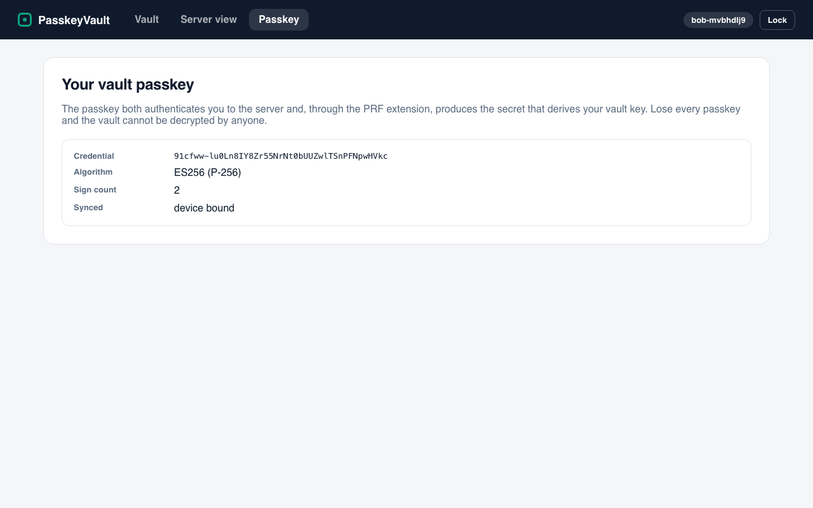

<p align="center"></p>

# Passkey POC

A WebAuthn (passkey) relying party written from scratch in Go with only the standard library, plus two Bun, Vite and TypeScript apps that use it:

* **Passkey Books**: a small bookstore. You create an account and sign in with a passkey, browse the catalog, fill a cart, check out and see your orders.
* **PasskeyVault**: a password manager in the style of LastPass. You unlock it with a passkey. The vault key is derived in the browser from the passkey PRF extension, so the server only ever stores ciphertext.

No WebAuthn library is used anywhere. The Go server parses CBOR, COSE keys, authenticator data and attestation objects itself and verifies every signature with `crypto/ecdsa`, `crypto/ed25519` and `crypto/rsa`.

## How it works

1. The UI posts a username to `/passkey/{app}/register/begin`. Vite proxies it to the Go server, which returns a random 32 byte challenge and a ceremony id.
2. The browser calls `navigator.credentials.create`. The authenticator makes a key pair and returns the public key inside a CBOR attestation object.
3. The Go server checks `clientDataJSON` (type, challenge, origin), the `rpIdHash`, the UP and UV flags, the attestation statement, and stores the COSE public key.
4. Login is the same dance with `navigator.credentials.get`: the authenticator signs `authenticatorData || SHA-256(clientDataJSON)` and Go verifies it with the stored key and checks the sign counter.
5. On success Go issues a random bearer token. It keeps only the SHA-256 of it, bound to the app and user.
6. The Bun APIs call `GET /api/session` on the Go server to introspect every token and refuse tokens issued for the other app.
7. The vault also asks for the PRF extension on login. The authenticator returns 32 secret bytes that are the same for every login with that passkey.
8. The vault runs HKDF-SHA-256 over those bytes to make a non extractable AES-256-GCM key. Every entry is encrypted in the browser, bound to its id as AAD, and only `{iv, ct}` is sent to the vault API.
9. Locking the vault drops the key. Unlocking runs the passkey again and re-derives the same key.

## Architecture



The diagram source is `diagram/architecture.html`.

## Features

* **WebAuthn from scratch in Go**: CBOR decoder, COSE key parser and ceremony checks with zero third party modules, so every rule is readable in one place.
* **ES256, EdDSA and RS256**: the three algorithms real authenticators use. RSA keys under 2048 bits are refused.
* **Invalid curve protection**: P-256 points are parsed with `ecdsa.ParseUncompressedPublicKey`, which rejects points that are not on the curve.
* **Phishing resistance**: `clientDataJSON.origin` must be the exact origin of the app and `rpIdHash` must match, so a look alike site gets nothing usable.
* **User verification required**: passkeys replace passwords, so a biometric or PIN (UV flag) is mandatory, not just a tap.
* **Single use, short lived challenges**: a ceremony is deleted on the first finish attempt, success or failure, and expires after 2 minutes.
* **Clone detection**: a sign counter that does not increase is rejected. Synced passkeys that always report 0 still work.
* **Attestation `none` and `packed`**: self attestation is verified with the credential key, `x5c` attestation with the leaf certificate.
* **Hostile CBOR handling**: lengths beyond the input, duplicate map keys, floats, trailing bytes and deep nesting are all rejected before allocating.
* **App scoped sessions**: a bookstore token is refused by the vault API even for the same username, and the reverse.
* **Hashed session tokens**: the server stores SHA-256 of each token, so a memory or file dump does not reveal usable tokens.
* **DNS rebinding guard**: the Go server only answers when the `Host` header is `localhost` or `127.0.0.1`.
* **Zero knowledge vault**: names, sites, usernames, passwords and notes are encrypted in the browser. The `Server view` tab shows the exact JSON the server holds.
* **Item swap protection**: each entry is encrypted with its id as AES-GCM additional data, so the server cannot move one ciphertext under another id.
* **Wrong passkey detection**: an encrypted canary is stored once, so a different passkey gets a clear error instead of garbage.
* **Password generator**: unbiased rejection sampling over `crypto.getRandomValues`, at least one character from every selected class, entropy shown in bits.
* **Auto lock**: the vault drops its key after 5 minutes without clicks or key presses.
* **Server side prices**: the bookstore cart only accepts a book id and a quantity, the price always comes from the server catalog.

## Stack

* **Go 1.26 standard library**: the passkey server, with no modules to audit.
* **Bun 1.4**: runs both APIs with `Bun.serve`, the workspaces and the unit tests.
* **TypeScript 7**: strict mode across the client package, both APIs and both UIs.
* **Vite 8**: dev server for each UI and a same origin proxy to the Go server and the app API.
* **Vanilla DOM**: a small `h()` helper instead of a framework. It never uses `innerHTML`, so user data cannot become markup.
* **Web Crypto**: HKDF and AES-256-GCM in the browser, with non extractable keys.
* **Playwright**: end to end tests in real Chromium with a CDP virtual authenticator that supports PRF.

## Layout

```
passkey-server/          Go WebAuthn relying party
  internal/cbor          CBOR decoder and a small encoder
  internal/cose          COSE_Key parsing and signature verification
  internal/webauthn      options, clientDataJSON, authenticatorData, registration, assertion
  internal/session       ceremonies and bearer sessions
  internal/store         JSON file store for users and credentials
  internal/softauth      software authenticator used by the Go tests
  internal/api           HTTP handlers
packages/passkey-client  browser side WebAuthn calls and base64url
packages/session-guard   token introspection used by both Bun APIs
packages/dom             h(), mount() and toast()
apps/bookstore/api       Bun API: catalog, cart, checkout, orders
apps/bookstore/web       Vite UI
apps/vault/api           Bun API: ciphertext store
apps/vault/web           Vite UI, crypto, generator
e2e                      Playwright end to end checks
scripts                  setup, start, stop, status, test, ui
```

## Contracts

### passkey-server (Go)

All bodies are JSON. Binary fields are base64url without padding. `{app}` is `bookstore` or `vault`.

| Method | Path | Body | Response |
|---|---|---|---|
| GET | `/api/health` | | `{status}` |
| POST | `/api/{app}/register/begin` | `{username}` | `{ceremonyId, publicKey}` creation options. `409` when taken |
| POST | `/api/{app}/register/finish` | `{ceremonyId, credential: {rawId, type, response: {clientDataJSON, attestationObject, transports}}}` | `{token, session}` |
| POST | `/api/{app}/login/begin` | `{username}` | `{ceremonyId, publicKey}` request options with `allowCredentials` |
| POST | `/api/{app}/login/finish` | `{ceremonyId, credential: {rawId, type, response: {clientDataJSON, authenticatorData, signature, userHandle}}}` | `{token, session}` |
| GET | `/api/{app}/passkeys` | Bearer token | `[{id, alg, signCount, attestationFmt, backupEligible, backedUp, transports}]` |
| GET | `/api/session` | Bearer token | `{app, username, userId, expiresAt}` or `401` |
| POST | `/api/logout` | Bearer token | `204` |

### bookstore-api (Bun)

| Method | Path | Auth | Body | Response |
|---|---|---|---|---|
| GET | `/api/books` | no | | `Book[]` |
| GET | `/api/cart` | yes | | `{lines, total}` |
| PUT | `/api/cart` | yes | `{bookId, qty}` with qty 0 to 10 | `{lines, total}` |
| POST | `/api/checkout` | yes | | `Order` |
| GET | `/api/orders` | yes | | `Order[]` |

### vault-api (Bun)

| Method | Path | Body | Response |
|---|---|---|---|
| GET | `/api/vault` | | `{canary, items: [{id, iv, ct, updatedAt}]}` |
| PUT | `/api/vault/canary` | `{iv, ct}` | `201`, or `409` when already set |
| PUT | `/api/vault/items/{uuid}` | `{iv, ct}` | the stored item |
| DELETE | `/api/vault/items/{uuid}` | | `204` |

Every vault route needs a bearer token issued for the `vault` app.

## Key data structures and design decisions

* **`webauthn.Credential`**: credential id, raw COSE public key, algorithm, sign count, AAGUID, attestation format, backup eligible and backed up flags, transports. The raw COSE bytes are stored so verification always reparses the exact key the authenticator sent.
* **`session.Ceremony`**: app, kind (`register` or `login`), username, user handle and challenge. Keyed by a random id, so the challenge never needs to round trip through a cookie.
* **One Go server, many apps**: each app is a relying party entry with its own name and allowed origin. Both apps use rp id `localhost`, and the origin check plus the app scoped user table keep their accounts separate.
* **Introspection instead of JWT**: the Bun APIs ask the Go server about each token. Logout is instant and no signing key is shared between services.
* **Username first login**: login sends `allowCredentials` for the named user. Both apps share rp id `localhost`, so discoverable login would offer passkeys from the other app.
* **PRF requested at creation**: `extensions: {prf: {}}` is sent on create so security keys enable `hmac-secret`. Without it the vault fails closed with a clear message.
* **Vault key derivation**: `HKDF-SHA-256(ikm = PRF output, salt = "passkey-vault", info = "vault-key/v1/<username>")` to a non extractable AES-256-GCM key.

## Known limits

* One passkey per vault. A second passkey would produce a different PRF output, so adding one needs key wrapping, which is not built.
* Login begin answers `404` for an unknown username, which lets someone enumerate usernames.
* Sessions and ceremonies live in memory, so restarting the Go server signs everyone out. Credentials persist in `data/passkeys.json`.
* `packed` attestation with `x5c` verifies the signature but does not check the certificate chain against a metadata service.

## Tests

* **Go** (`passkey-server`): CBOR vectors from RFC 8949 and hostile inputs, COSE invalid curve points, weak RSA and algorithm confusion. Registration and login for all three algorithms with a software authenticator, phishing origin, wrong rp id, replayed challenge, tampered signature, foreign authenticator, missing UV, cloned counter, synced zero counter and type confusion. API checks for username takeover, cross app passkeys, single use ceremonies and foreign `Host`. Store and session checks for persistence, file mode, expiry and hashed tokens.
* **Bun**: cross app token refusal, server side prices, cart isolation, input validation, ciphertext only payloads, set once canary, uuid ids, `0600` vault file, vault key derivation, wrong passkey detection, AAD binding, non extractable key, fresh IVs and the generator.
* **E2E**: 13 checks in real Chromium with a virtual authenticator, covering both apps and the cross app refusal.

```
ok 1 - bookstore refuses sign in for a username with no passkey
ok 2 - bookstore signup with a passkey shows the catalog
ok 3 - cart total is computed by the server from catalog prices
ok 4 - checkout creates an order
ok 5 - security tab lists the ES256 passkey stored by the Go server
ok 6 - a logged out bookstore token is rejected by the API
ok 7 - the same passkey signs in again
ok 8 - a valid bookstore session token is refused by the vault API
ok 9 - vault created: passkey registered, PRF output derived the key, canary stored
ok 10 - three entries encrypted and saved
ok 11 - server copy holds ciphertext only, no names, sites or passwords
ok 12 - after lock and unlock the passkey PRF re-derives the key and decrypts the password
ok 13 - a device without the vault passkey cannot unlock it
```

Set `SCREENSHOTS_DIR=../printscreens` when running `bun passkey.e2e.ts` from `e2e/` to refresh the screenshots below.

## Printscreens

### Passkey Books: sign in



The bookstore has no password field. Create account registers a new passkey for the username. Sign in asks the authenticator to sign a fresh challenge.

### Passkey Books: catalog



Right after signup the Go server issued a session token and the catalog loads. The search box filters by title, author or topic.

### Passkey Books: cart



Two books in the cart. The total is calculated by the bookstore API from its own catalog, the browser only sends book ids and quantities.

### Passkey Books: orders



Checkout turned the cart into an order and emptied the cart.

### Passkey Books: security



The passkey as the Go server stored it: credential id, algorithm, sign counter, sync state and transports.

### PasskeyVault: locked



Create a new vault registers a passkey and then uses it once more to get the PRF output. Unlock repeats only the second step.

### PasskeyVault: entries



Three logins decrypted in the browser. The editor encrypts on save. The generator on the right builds a 20 character password with 126 bits of entropy.

### PasskeyVault: server view



The exact JSON the vault API returns. Only ids, IVs, ciphertext and timestamps. The canary lets the UI detect a wrong passkey.

### PasskeyVault: passkey



The vault passkey details. That passkey is both the login and the only source of the vault key.

## Scripts

All scripts live in `scripts/` and run from any directory of the repository.

| Script | What it does |
|---|---|
| `./scripts/setup.sh` | Builds the Go server, installs Bun workspaces and Playwright Chromium |
| `./scripts/start-all.sh` | Starts every service and prints the full link of each one |
| `./scripts/status.sh` | Shows every service port as UP or DOWN |
| `./scripts/test-all.sh` | Runs Go vet and tests, the typecheck, Bun tests and the e2e checks |
| `./scripts/ui.sh` | Opens both UIs in the browser |
| `./scripts/stop-all.sh` | Stops every service |

Ports are declared in `scripts/ports.env`: passkey server `8090`, bookstore API `4001`, vault API `4002`, bookstore UI `5173`, vault UI `5174`.

```bash
./scripts/setup.sh
./scripts/start-all.sh
./scripts/status.sh
./scripts/test-all.sh
./scripts/ui.sh
./scripts/stop-all.sh
```

Open `http://localhost:5173` for the bookstore and `http://localhost:5174` for the vault. Passkeys need `localhost` or HTTPS, so use `localhost` and not `127.0.0.1`. The vault needs an authenticator with PRF support, such as iCloud Keychain on recent macOS, Google Password Manager or a FIDO2 key with `hmac-secret`.
